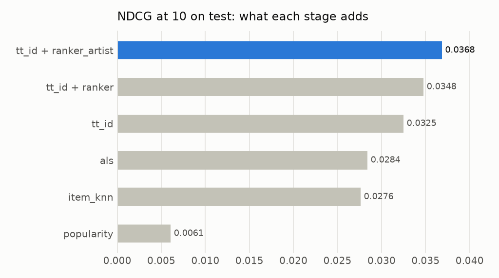
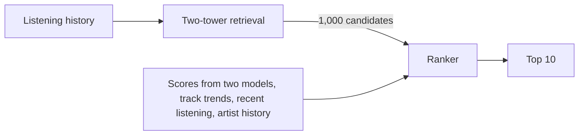
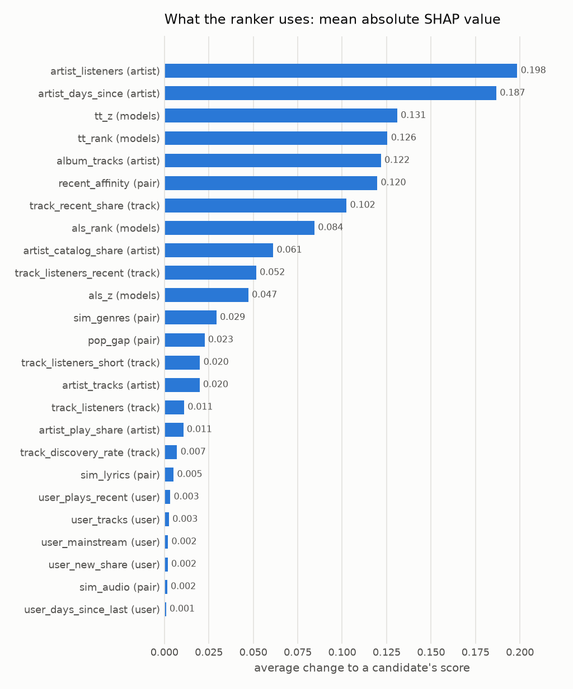
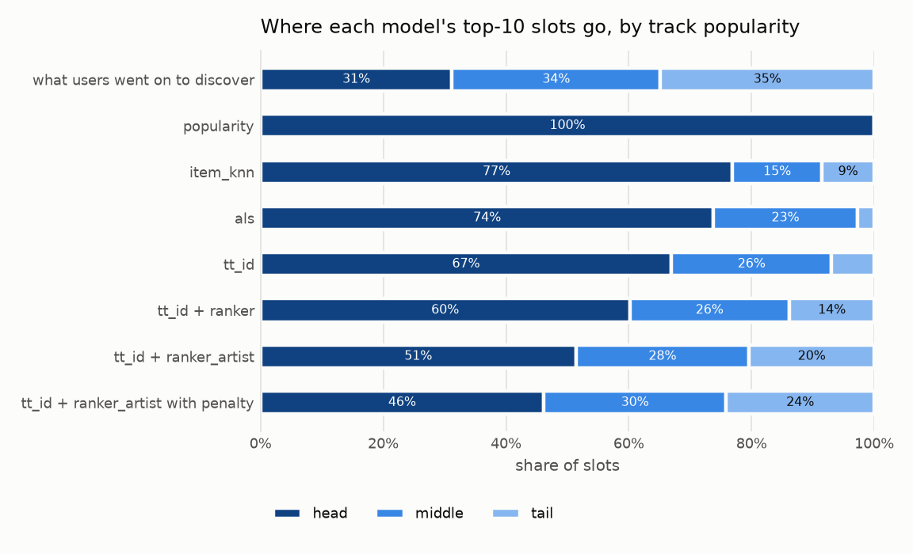
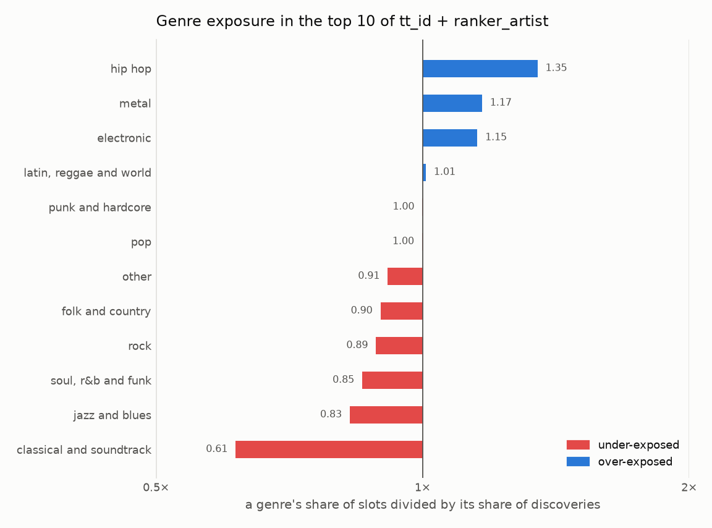
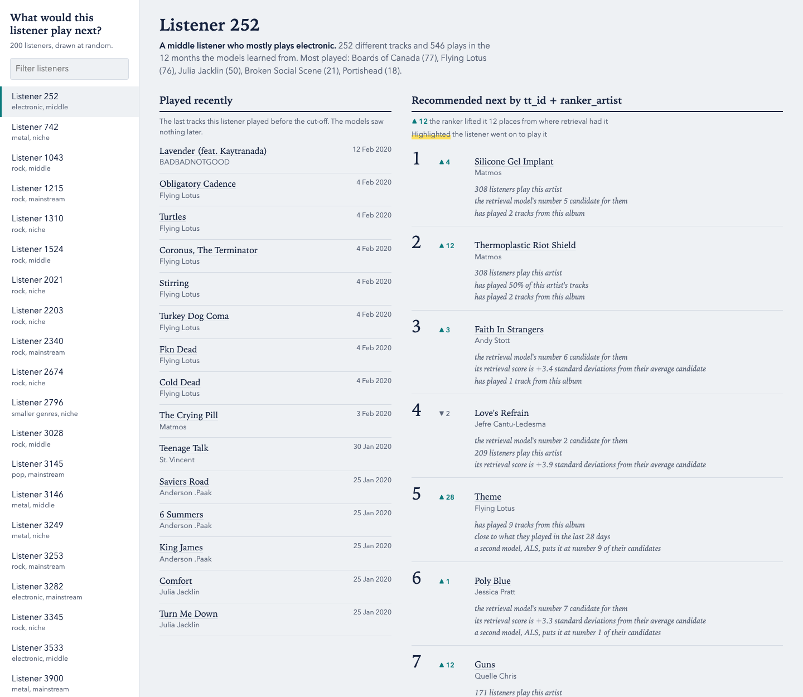
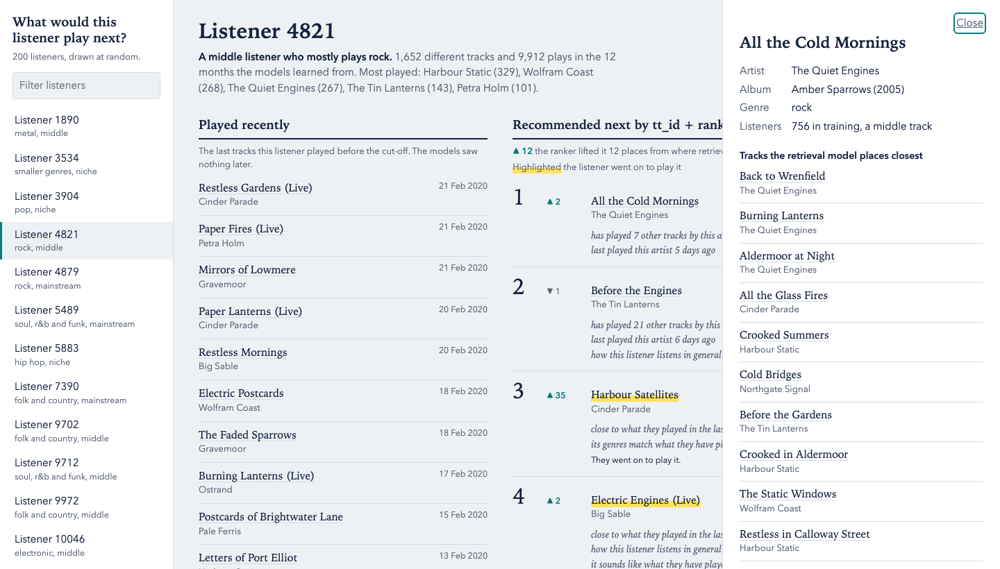

# Two-stage music recommender on Music4All-Onion

By Zunhong (Quentin) Mei, M.S. in Data Science, Columbia University.

A recommender built the way production systems are: a two-tower neural network
(PyTorch) retrieves 1,000 candidate tracks for each listener, and a gradient-boosted
ranker (XGBoost, LambdaRank) reorders the best 500 of them. It is trained on 13 months
of Last.fm listening (17.5 million plays, 14,366 listeners, 56,203 tracks), scored on a
strict split by time, compared with three standard baselines, and then examined for
popularity bias and genre fairness. It also runs as a local API that recommends for
listeners the models have never seen, from the listens they hand in.

## Results

A model is scored on the tracks a listener plays for the first time in the two weeks
after training ends. On `test`, 10,280 listeners, with every model fitted on the same
data:

| Model | Recall@10 | NDCG@10 | Recall@100 | Coverage@10 |
|---|---|---|---|---|
| Most popular tracks | 0.0042 | 0.0061 | 0.0292 | 0.1% |
| Item-kNN | 0.0208 | 0.0276 | 0.1088 | 19.7% |
| ALS matrix factorisation | 0.0244 | 0.0284 | 0.1356 | 22.0% |
| Two-tower retrieval (`tt_id`) | 0.0278 | 0.0325 | 0.1468 | 28.7% |
| Retrieval + ranker | 0.0310 | 0.0348 | 0.1508 | 33.5% |
| Retrieval + ranker with artist features | 0.0338 | 0.0368 | 0.1610 | 39.1% |



- **Against ALS**, the strongest baseline, the full system is 30% ahead on NDCG@10 and
  39% on Recall@10.
- **Each stage earns its place.** Retrieval alone beats ALS by 14%. The ranker adds
  +0.0044 NDCG@10 on top of retrieval (95% interval +0.0027 to +0.0060), and the artist
  features account for +0.0021 of that (+0.0006 to +0.0036).
- **It also recommends more widely**: its top 10s reach 39% of the catalogue, against
  22% for ALS.

The numbers are small because the task is hard: only tracks new to the listener count,
out of 56,000, and a listener has a median of 8 of them. Random recommendations score
Recall@10 = 0.00015. Intervals come from resampling listeners 2,000 times.

## How it works



- **Retrieval.** One network turns a listener into a vector and another turns a track
  into one; a track is a candidate when the two line up. It is trained with an in-batch
  softmax loss corrected for track popularity.
- **Ranking.** A LambdaRank model scores each candidate from 25 features: its scores
  from the two-tower model and from ALS, how the track is trending, how close it is to
  what the listener played in the last four weeks, and what the listener has already
  played by the same artist.
- **No look-ahead.** The window is cut by time into training for retrieval, training for
  the ranker, `val` and `test`. The ranker is trained in one moment and used in a later
  one, and in both it sees only the past. A test fails if any model code names a
  held-out file.

## What the experiments showed

- **The loss correction mattered most in retrieval.** Without correcting for popular
  tracks turning up as wrong answers, the two-tower model scored below item-kNN
  (Recall@100 of 0.094 against 0.138 on `val`).
- **Content features help only where there is no listening.** For known tracks they add
  nothing. For tracks removed from training entirely, a content-only tower finds 28% of
  a listener's new tracks in its top 100, against 20% for comparing raw features and 4%
  at random.
- **Shallow trees win in the ranker.** Depth 2 or 3 is best and anything deeper is
  worse: about 1% of candidates are right, and deep trees fit one month's quirks.
- **A plain yes/no objective matches LambdaRank** on NDCG@10. LambdaRank is kept because
  its lists cover more of the catalogue.
- **XGBoost's default pairing method (`topk`) is unstable on this data.** It trained
  smoothly on the full feature set and fell below plain retrieval order when a feature
  group was removed. The `mean` method scores the same and stays stable.
- **Artist history is the ranker's most useful group.** 61% of the tracks a listener
  discovers are by an artist they already play. Removing those features costs 12% of
  NDCG@10 on `val`, more than removing the model scores.



## Who the system serves

Measured on each listener's top 10 on `test`. Tracks are cut into head, middle and tail
so that each third holds a third of all training listening: 3,505 head tracks, 10,446
middle and 42,238 tail.



- **Every model favours popular tracks.** What listeners go on to discover is spread
  evenly: 31% head, 34% middle, 35% tail. ALS gives the head 74% of its slots and the
  final system 51%.
- **Each stage reduces the bias while raising accuracy.** The tail's share of slots goes
  from 3% (ALS) to 7% (retrieval) to 20% (final system), and the share of tail
  discoveries found in the top 10 triples from retrieval to the final system, from 0.4%
  to 1.1%.
- **Niche listeners score lowest under every model**, 0.035 NDCG@10 against 0.038 for
  the other two thirds in the final system, but the intervals overlap, so the gap is
  not established.
- **Genres are not treated alike.** Against their share of discoveries, the final system
  over-shows hip hop (1.35 times), metal (1.17) and electronic (1.15), and under-shows
  classical and soundtrack (0.61), jazz and blues (0.83) and soul (0.85). NDCG@10 by a
  listener's main genre runs from 0.034 to 0.047 with overlapping intervals, so there is
  no evidence that one group of fans is served worse.



**One fix, and its price.** Marking popular candidates down at ranking time moves the
tail's share of slots from 20.4% to 24.1% and coverage from 39.1% to 41.8%, for 1.9% of
NDCG@10 (−0.0007, interval −0.0011 to −0.0004). The strength was picked on `val` by a
rule fixed in advance: the largest that costs under 2%. There is no free gain: every
step towards the tail costs accuracy.

Full tables: `reports/bias.md` and `reports/bias_tuning.md`.

## Demo

A single HTML page for exploring the results. Pick one of 200 listeners to see what
they played recently, the system's top 10 with the ranker's reasons in words, how far
the ranker moved each track from its retrieval position, and a mark where the listener
went on to play it. Every model's list is shown side by side, and any track opens its
nearest tracks from a FAISS index over the retrieval model's vectors.





*The screenshots show an invented listener, tracks and artists, not data from Music4All.*

The page is built locally and is not hosted: it contains titles and artists from the
Music4All database, which is shared for research only. To build it:

```bash
python -m m4a_rec.index data/processed/models/tt_id_refit
python -m m4a_rec.demo        # writes data/processed/demo/index.html; open it in a browser
```

## Use it: a local API

The trained system also runs as a service. Both stages run at request time, and it
recommends for any listener, including someone the models never saw, from their listens.

```bash
python -m m4a_rec.bundle      # gathers the trained models into data/processed/serving/, seconds
python -m m4a_rec.api         # then open http://127.0.0.1:8000/docs to try every call
```

| Call | Returns |
|---|---|
| `GET /users/{user_id}/recommendations?k=10` | a listener in the data, from the vector learned for them |
| `POST /recommendations` | anyone, from their listens: `{"plays": [{"track_id": "...", "timestamp": "..."}], "k": 10}` |
| `GET /tracks/{track_id}/similar?k=10` | the nearest tracks in the retrieval model's space |
| `GET /health` | what the service holds |

Each recommendation comes with its place before the ranker and, unless `explain=false`,
the ranker's reasons in words. Track IDs are Music4All's. A listen without a time counts
as played when the data ends (21 February 2020), and IDs not in the catalogue are named
in the reply.

- **Someone new gets vectors from their listens**, with no training at request time: the
  average direction of their tracks in the retrieval model's space, and ALS's own
  least-squares solve against its track vectors.
- **It reproduces the offline results.** Run for all 14,350 listeners, it gives every one
  of them the same top 10 as the saved lists, and the same scores on `val` and `test`.
- **New listeners do nearly as well in the top 10.** 1,435 listeners were left out of the
  retrieval model and ALS, then served from their listens alone. On `test` they score
  NDCG@10 = 0.0332, against 0.0351 when the models had trained on them (difference
  −0.0020, interval −0.0055 to +0.0015) and 0.0063 for the most popular tracks. Deeper
  in the list the gap is real: Recall@500 is 0.30 against 0.36. The ranker matters more
  for them, lifting NDCG@10 from 0.0269 for retrieval alone. It had seen their earlier
  listens in training, so this is slightly optimistic.
- **Fast:** a median of 21 ms per request for a known listener and 56 ms for someone new,
  on an Apple-silicon Mac with 10 cores.

**Docker.** `make docker-build && make docker-run` runs the same service in a container.
The image holds code only, no PyTorch, 314 MB compressed. The bundle is mounted
read-only when the container starts, and the port is published on this machine only.

Like the demo, the service stays on this machine: its replies carry titles and artists
from the Music4All database, which is shared for research only. Full numbers are in
`reports/serving.md`.

## Limits

- **Offline evaluation only.** A listener playing a track is taken as wanting it. There
  are no skips, likes or play lengths in the data, and no way to test what a listener
  would have done with a different list.
- **Two weeks of `test`, one dataset.** Settings were picked on `val`, and gains there
  were about twice what `test` confirmed, which is why every claim above is a `test`
  number with an interval.
- **The ranker can only reorder what retrieval finds.** A listener's top 500 candidates
  hold about a third of what they go on to discover.
- **Genre groups come from keyword rules** on each track's first-listed label, and some
  calls are debatable. Small groups have wide intervals.
- **Bias is measured against what listeners went on to play**, which was itself shaped
  by whatever was recommending music to them at the time.

What I would do next: add unplayed tracks by a listener's artists as a second source of
candidates, replace the one-vector-per-listener tower with one that reads recent
listening, so that a new listener's vector is learned rather than averaged from their
tracks, and train the ranker with a loss that
corrects for popularity instead of penalising it afterwards.

## Reproduce it

```bash
python -m venv .venv && source .venv/bin/activate
pip install -e ".[train,serve,dev]"   # the service alone needs only ".[serve]"
pytest -q                             # 117 tests, a few seconds
```

Music4All-Onion downloads itself (about 3 GB). The base Music4All dataset, needed from
`metadata` onwards, has to be requested from its authors and unpacked to
`data/raw/music4all/`. On macOS, XGBoost needs `brew install libomp` if it is not found.

| Step | Commands | Writes |
|---|---|---|
| Data and audit | `python -m m4a_rec.download`, `prepare convert`, `prepare subsample`, `audit` | `reports/audit.md` |
| Splits | `python -m m4a_rec.split`, `evaluate` | four splits by time |
| Baselines | `python -m m4a_rec.baselines tune`, `report` | `reports/baselines.md` |
| Retrieval | `python -m m4a_rec.features`, `retrieval tune tt_id`, `retrieval report`, `coldstart report` | `reports/retrieval.md`, `reports/coldstart.md` |
| Refit on all training data | `python -m m4a_rec.baselines refit`, `retrieval refit` | each model's lists |
| Ranker | `python -m m4a_rec.metadata`, `candidates`, `ranker tune ranker_artist`, `ranker fit ranker`, `ranker fit ranker_artist`, `ranker report` | `reports/ranker.md` |
| Bias and fairness | `python -m m4a_rec.bias tune`, `bias report` | `reports/bias.md` |
| Demo | `python -m m4a_rec.index data/processed/models/tt_id_refit`, `demo` | the demo page |
| Service | `python -m m4a_rec.newcomers`, `bundle newcomers`, `bundle`, `serve report` | `reports/serving.md`, the bundle the API serves |

The `Makefile` wraps these. The window is cut by time into four parts:

| Split | Period | Listens | Used for |
|---|---|---|---|
| `retrieval_train` | 2019-02-20 to 2020-01-24 | 15,105,295 | training the retrieval model and baselines |
| `ranker_train` | 28 days to 2020-02-21 | 1,204,592 | training the ranker |
| `val` | 14 days to 2020-03-06 | 586,655 | tuning |
| `test` | 14 days to 2020-03-20 | 584,036 | the reported numbers |

The baselines and the two-tower models were first compared when fitted on
`retrieval_train` alone (`reports/baselines.md`, `reports/retrieval.md`). The table at
the top refits every model on both training splits, which is why its numbers are a
little higher.

## Layout

```
configs/        one YAML file per step: every tunable number lives here
src/m4a_rec/    one module per step
  download, prepare, audit, split    data, audit and the split by time
  evaluate                           the only module that reads val and test
  interactions, baselines            shared user-by-track matrix; popularity, item-kNN, ALS
  features, twotower, retrieval      content features, the towers and loss, training
  coldstart, index                   the cold-start test, the FAISS index
  metadata, rank_features            titles and genres; the ranker's features
  candidates, ranker                 the ranker's two snapshots; training, SHAP, reports
  bias, demo                         bias and fairness measures; the demo page
  bundle, serve, api                 the service: its bundle, both stages at request time, HTTP
  newcomers                          the models refitted without 10% of listeners, for the new-listener test
tests/          hand-checked tests on synthetic data
reports/        decisions.md (every design choice and why) and the generated reports
CLAUDE.md       project brief and rules for Claude Code
```

`reports/decisions.md` records each design choice with its reason and what was rejected.

## Data and citation

The code is under the MIT licence (see `LICENSE`). The datasets are not covered by it and
keep their own terms.

Listening data and content features: Music4All-Onion, Zenodo record 6609677, CC BY 4.0.

> Marta Moscati, Emilia Parada-Cabaleiro, Yashar Deldjoo, Eva Zangerle and Markus
> Schedl. Music4All-Onion: A Large-Scale Multi-faceted Content-Centric Music
> Recommendation Dataset. CIKM 2022.

Track titles, artists and genres: the Music4All database, used under its agreement for
research purposes only. It is not included in this repository and is available from its
authors on request.

> Igor André Pegoraro Santana, Fabio Pinhelli, Juliano Donini, Leonardo Catharin, Rafael
> Biazus Mangolin, Yandre Maldonado e Gomes da Costa, Valéria Delisandra Feltrim and
> Marcos Aurélio Domingues. Music4All: A New Music Database and its Applications. In:
> 27th International Conference on Systems, Signals and Image Processing (IWSSIP 2020),
> 2020, Niterói, Brazil. p. 399-404.
