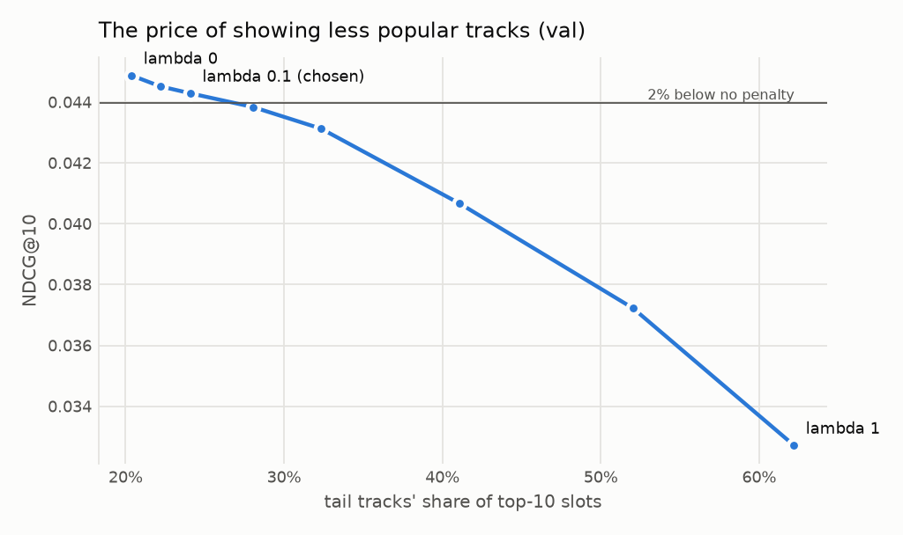

# Popularity penalty tuning

Generated by `python -m m4a_rec.bias tune`. Do not edit by hand; rerun instead.

`tt_id + ranker_artist` on val. A candidate's score is its ranker score minus `lambda` times its popularity,
both standardised within the user's list. Rule fixed in advance: the largest `lambda` that
costs under 2% of NDCG@10. That is `lambda` = 0.1.

| lambda | NDCG@10 | Change | Head slots | Middle slots | Tail slots | Coverage@10 | Gini |
|---|---|---|---|---|---|---|---|
| 0 | 0.0449 | +0.0% | 51.5% | 28.1% | 20.4% | 39.1% | 0.842 |
| 0.05 | 0.0445 | -0.8% | 48.9% | 28.9% | 22.2% | 40.5% | 0.831 |
| 0.1 | 0.0443 | -1.3% | 46.3% | 29.6% | 24.1% | 41.9% | 0.819 |
| 0.2 | 0.0438 | -2.3% | 41.0% | 30.9% | 28.1% | 44.6% | 0.796 |
| 0.3 | 0.0431 | -3.9% | 35.8% | 31.9% | 32.3% | 47.3% | 0.771 |
| 0.5 | 0.0407 | -9.4% | 25.9% | 33.0% | 41.1% | 51.8% | 0.725 |
| 0.75 | 0.0372 | -17.1% | 15.7% | 32.3% | 52.0% | 56.3% | 0.679 |
| 1 | 0.0327 | -27.1% | 8.2% | 29.6% | 62.2% | 59.1% | 0.655 |
